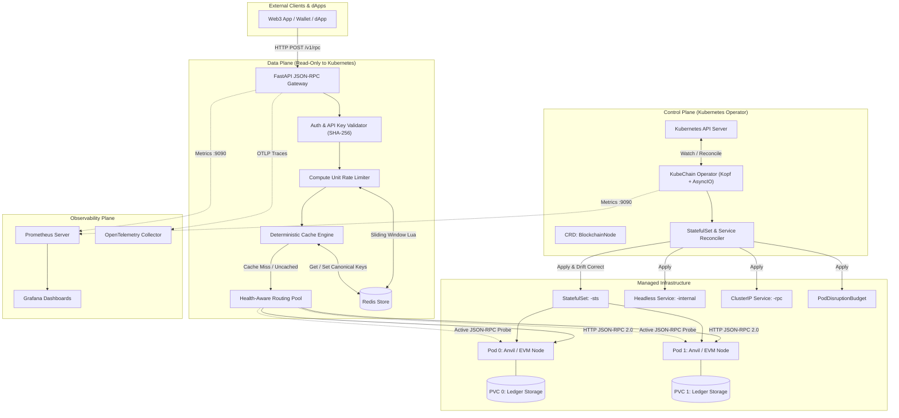
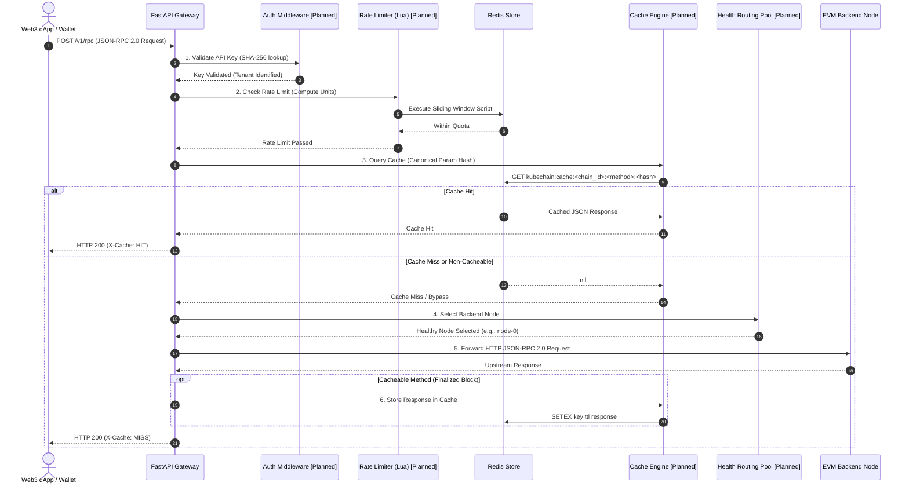

# KubeChain

**Kubernetes-Native Blockchain Infrastructure Orchestration Platform**

[](https://github.com/aniruddhajadhav7/kubechain/actions/workflows/ci.yaml)
[](https://www.python.org/)
[](https://kubernetes.io/)
[](https://kopf.readthedocs.io/)
[](https://fastapi.tiangolo.com/)
[](https://redis.io/)
[](https://prometheus.io/)
[](https://opentelemetry.io/)

KubeChain is an engineering platform designed to declaratively provision, manage, monitor, and expose EVM-compatible blockchain RPC infrastructure on Kubernetes. By bridging cloud-native operational paradigms with the specific demands of stateful, append-only blockchain nodes, KubeChain automates the reconciliation of node workloads, dynamically classifies synchronization and head lag, routes JSON-RPC traffic with reorg-aware caching, and enforces compute-unit rate limits while isolating public proxy traffic from Kubernetes control plane operations.

> **Project Status**: **Active Development / Pre-Alpha**. The technical architecture, component designs, CRD schemas, ADRs, and verification harness are fully specified. Application workloads and reconcilers are being implemented incrementally according to the [Engineering Roadmap](docs/ROADMAP.md).

---

## Table of Contents

- [Overview](#overview)
- [Key Engineering Capabilities](#key-engineering-capabilities)
- [Architecture](#architecture)
- [Request Lifecycle](#request-lifecycle)
- [Repository Structure](#repository-structure)
- [Technology Stack](#technology-stack)
- [Getting Started](#getting-started)
- [Configuration](#configuration)
- [Observability and Monitoring](#observability-and-monitoring)
- [Testing and Reliability](#testing-and-reliability)
- [Security Considerations](#security-considerations)
- [Architecture Decision Records](#architecture-decision-records)
- [Roadmap](#roadmap)
- [Contributing](#contributing)
- [License](#license)

---

## Overview

Operating blockchain RPC infrastructure at scale presents unique distributed systems challenges that standard web application proxies and ingress controllers are not built to resolve:

1. **Stateful Append-Only Workloads**: Blockchain nodes maintain hundreds of gigabytes of persistent state across blocks and trie databases. They require stable network identities, dedicated storage volumes, and controlled rolling updates to prevent database corruption.
2. **Synchronization and Head Lag**: Nodes can fall out of synchronization with the network head, stall on consensus validation, or drop peers. Routing traffic to an unsynchronized node returns stale state to clients without generating explicit HTTP errors.
3. **Ambiguous JSON-RPC Semantics**: Unlike standard REST APIs where HTTP methods convey idempotency (`GET` vs. `POST`), Ethereum JSON-RPC transmits all commands over HTTP POST. Blind retries on dropped connections can cause fatal errors (e.g., `nonce too low` or duplicate transaction execution for `eth_sendRawTransaction`).
4. **Cache Invalidation & Chain Reorganizations**: In EVM networks, recent blocks are subject to reorganizations until finalized by consensus. Caching unfinalized block data immutably poisons client caches if a reorg discards that block.
5. **Compute-Unit Resource Disparity**: Lightweight calls (`eth_blockNumber`) require negligible node CPU, whereas computational queries (`eth_call` against complex state) or log filtering (`eth_getLogs` over thousands of blocks) can exhaust node memory. Standard request-count rate limiters fail to protect nodes against asymmetric query attacks.
6. **Control Plane Saturation**: Coupling external proxy traffic directly to the Kubernetes API to locate healthy pods risks saturating the `kube-apiserver` during traffic spikes.

### The Kubernetes-Native Solution

KubeChain addresses these operational problems through declarative Kubernetes Custom Resources (`BlockchainNode`) and a strict separation of concerns between its Control Plane and Data Plane:

- **Declarative Reconciliation**: The Operator acts as a genuine Kubernetes controller, continuously reconciling desired specs with actual cluster state, correcting configuration drift, and exposing granular status conditions.
- **Isolated Data Plane**: The Gateway routes traffic using local, in-memory discovery pools fed by active background probing, ensuring the Kubernetes API is never queried on the critical request path.
- **Protocol-Aware Proxying**: The Gateway distinguishes idempotent reads from stateful writes, canonicalizes cache keys with reorg-aware TTLs, and enforces sliding-window rate limits based on method-specific Compute Units.

---

## Key Engineering Capabilities

| Capability | Description | Status |
| :--- | :--- | :--- |
| **Declarative Node Orchestration** | Manage blockchain nodes via the `BlockchainNode` Custom Resource (`infra.kubechain.io/v1alpha1`). | Specified / Planned |
| **Automated Workload Reconciliation** | Kopf-based operator continuously reconciles StatefulSets, Headless Services, ClusterIP Services, PVCs, and PDBs. | Specified / Planned |
| **Drift Correction & Recovery** | Detects manual changes to managed Kubernetes child resources and autonomously restores desired state. | Specified / Planned |
| **Active Health & Lag Classification** | Probes nodes for `eth_chainId`, `eth_blockNumber`, `eth_syncing`, and latency; classifies states as `HEALTHY`, `SYNCING`, `LAGGING`, `DEGRADED`, or `UNREACHABLE`. | Specified / Planned |
| **JSON-RPC 2.0 Compliance** | Validates single and batch JSON-RPC 2.0 payloads, preserves request IDs, and frames standard error responses. | Specified / Planned |
| **Method-Aware Safe Retries** | Retries idempotent read queries on transient upstream 5xx/timeouts; enforces strictly **zero retries** for `eth_sendRawTransaction`. | Specified / Planned |
| **Compute Unit (CU) Rate Limiting** | Redis-backed sliding-window rate limiting weighting requests by computational cost (e.g., `eth_blockNumber`=10 CU, `eth_sendRawTransaction`=100 CU). | Specified / Planned |
| **Reorg-Safe Deterministic Caching** | Normalizes parameters and generates SHA-256 cache keys; enforces long TTLs for finalized blocks and bypasses unfinalized/pending state. | Specified / Planned |
| **Fail-Open Resilience** | Gracefully catches Redis partition or connection failures, falling back to upstream execution without dropping user traffic. | Specified / Planned |
| **Bounded-Cardinality Observability** | Prometheus metrics avoiding high-cardinality labels, paired with OpenTelemetry distributed trace context propagation. | Specified / Planned |
| **Automated Testing Harness** | Base testing harness asserting Python runtime requirements, structural directory layout, and architectural documentation. | **Implemented** |
| **Architecture Decision Records** | Documented technical trade-offs regarding operator framework, boundary isolation, and caching/retry semantics. | **Implemented** |

---

## Architecture

KubeChain partitions system responsibilities across three decoupled planes:



### 1. Control Plane (`operator/`)
- **Technology**: Python 3.12+, [Kopf](https://kopf.readthedocs.io/), `kubernetes-asyncio`.
- **Responsibilities**: Watches `BlockchainNode` Custom Resources. Generates and reconciles StatefulSets, Headless Services (`<name>-internal`), ClusterIP Services (`<name>-rpc`), and PodDisruptionBudgets (`<name>-pdb`). Emits Kubernetes events and updates `.status.conditions`.
- **Isolation Invariant**: Does not inspect, handle, or route JSON-RPC client traffic.

### 2. Data Plane (`gateway/`)
- **Technology**: Python 3.12+, [FastAPI](https://fastapi.tiangolo.com/), [HTTPX](https://www.python-httpx.org/), [Redis](https://redis.io/).
- **Responsibilities**: Validates incoming JSON-RPC 2.0 requests, authenticates hashed API keys, executes sliding-window rate limiting, performs canonical cache lookups, routes requests to healthy nodes, and applies method-specific retry semantics.
- **Isolation Invariant**: Has **zero infrastructure write permissions**. The Gateway never creates, scales, or deletes Kubernetes resources.

### 3. Observability & Reliability Plane (`observability/`, `chaos/`)
- **Technology**: [Prometheus](https://prometheus.io/), [OpenTelemetry](https://opentelemetry.io/), [Grafana](https://grafana.com/), [Chaos Mesh](https://chaos-mesh.org/), [k6](https://k6.io/).
- **Responsibilities**: Collects runtime metrics without unbounded cardinality labels, traces request execution across middleware and upstreams, and runs chaos experiments (pod kills, network partitions) to verify failure recovery.

---

## Request Lifecycle

The diagram below details the path of an incoming JSON-RPC 2.0 request through the Gateway:



---

## Repository Structure

```
Kubechain/
├── .github/
│   └── workflows/
│       └── ci.yaml               # GitHub Actions CI workflow (lint, typecheck, tests)
├── api/                          # Kubernetes CRD schemas and Pydantic representations
│   └── v1alpha1/                 # Versioned API definitions
├── chaos/                        # Chaos Mesh experiment definitions and failure configs
├── deploy/                       # Kubernetes manifests and infrastructure configurations
│   ├── crds/                     # Custom Resource Definitions
│   ├── helm/                     # Helm charts for KubeChain components
│   ├── local/                    # Local development configs (kind cluster configs)
│   ├── network-policies/         # Pod network isolation policies
│   └── rbac/                     # Least-privilege ServiceAccounts, Roles, and Bindings
├── docs/                         # Technical architecture documentation and runbooks
│   ├── architecture/             # System design, component specs, data flows, security
│   ├── decisions/                # Architecture Decision Records (ADRs)
│   ├── experiments/              # Reliability and chaos experiment logs
│   └── ROADMAP.md                # Phased development milestones and progress tracking
├── gateway/                      # Asynchronous FastAPI JSON-RPC 2.0 gateway
├── infra/                        # Infrastructure as Code
│   └── terraform/                # Terraform modules (AWS EKS, VPC, IAM)
├── node_manager/                 # Blockchain node health evaluators and probing engines
├── observability/                # Observability configuration artifacts
│   ├── grafana/                  # Grafana dashboard JSON models
│   ├── otel/                     # OpenTelemetry collector configurations
│   └── prometheus/               # Prometheus recording and alerting rules
├── operator/                     # Kopf Kubernetes operator controller and reconcilers
├── tests/                        # Comprehensive automated test suites
│   ├── e2e/                      # End-to-end tests running on kind
│   ├── fixtures/                 # Deterministic blockchain payloads and mock responses
│   ├── integration/              # Component integration tests
│   ├── load/                     # k6 performance and throughput scenarios
│   └── unit/                     # Fast unit tests for logic and schema validation
├── .env.example                  # Environment configuration template
├── .gitignore                    # Git ignore file for Python, K8s, and local environments
├── pyproject.toml                # Root packaging, Ruff, Mypy, and Pytest configuration
└── README.md                     # Platform technical overview and documentation
```

---

## Technology Stack

| Domain | Technology | Purpose | Status in Repository |
| :--- | :--- | :--- | :--- |
| **Orchestration** | Kubernetes v1.30+ | Container orchestration & workload state | Configured |
| **Controller Framework** | Kopf 1.37+ | Python Kubernetes Operator runtime | Dependency configured |
| **Kubernetes Client** | `kubernetes-asyncio` 30.0+ | Non-blocking Kubernetes API interaction | Dependency configured |
| **Cluster Runtime** | `kind` | Local Kubernetes development environment | Planned (Phase 1) |
| **Packaging** | Helm 3 | Chart-based deployment management | Planned (Phase 8) |
| **API Runtime** | Python 3.12+ / FastAPI / Uvicorn | High-concurrency async JSON-RPC service | Dependency configured |
| **HTTP Engine** | HTTPX 0.27+ | Async upstream client with connection pooling | Dependency configured |
| **Schema Validation** | Pydantic 2.7+ | JSON-RPC 2.0 and CRD schema validation | Dependency configured |
| **Blockchain Backend** | Foundry / Anvil | Deterministic local EVM development node | Planned (Phase 1) |
| **Data Store & Cache** | Redis 5.0+ | Sliding-window rate limiting & RPC caching | Dependency configured |
| **Metrics** | Prometheus Client 0.20+ | System and RPC metrics exposition | Dependency configured |
| **Distributed Tracing** | OpenTelemetry 1.24+ | W3C context propagation and trace spans | Dependency configured |
| **Dashboards** | Grafana | Operational monitoring visualization | Planned (Phase 6) |
| **IaC** | Terraform | Production AWS EKS infrastructure blueprints | Planned (Phase 9) |
| **Linter / Formatter** | Ruff 0.3+ | Fast Python static analysis and formatting | Configured & Passing |
| **Type Checker** | Mypy 1.9+ | Strict static type verification | Configured & Passing |
| **Test Runner** | Pytest 8.0+ / `pytest-asyncio` | Unit and integration test execution | Configured & Passing |

---

## Getting Started

### Prerequisites

Verify the following tools are installed on your host system:
- **Python 3.12+**
- **Docker** (v24+)
- **kubectl** (v1.30+)
- **kind** (v0.22+)
- **Helm** (v3.14+)

### Developer Environment Setup

The repository is configured using standard Python packaging (`pyproject.toml`). Follow these steps to prepare a local development environment:

```bash
# 1. Clone the repository
git clone https://github.com/aniruddhajadhav7/kubechain.git
cd kubechain

# 2. Create and activate a Python virtual environment
python3 -m venv .venv
source .venv/bin/activate

# 3. Upgrade pip and install development dependencies
pip install --upgrade pip
pip install -e ".[dev]"

# 4. Copy the environment configuration template
cp .env.example .env
```

### Running Static Checks and Tests

```bash
# Run Ruff linting checks
ruff check .

# Run Ruff formatting checks
ruff format --check .

# Run Mypy static type analysis
mypy tests/unit/test_foundation.py api operator gateway node_manager

# Run automated unit test suite
pytest
```

> **Note on Kubernetes Deployment**: Full end-to-end Kubernetes cluster deployment is currently in active development. Local `kind` cluster provisioning and deterministic Anvil backend integration will be introduced in [Phase 1](docs/ROADMAP.md).

---

## Configuration

Platform components are configured via environment variables. The table below documents the variables supported in [.env.example](.env.example):

| Variable | Description | Default | Required |
| :--- | :--- | :--- | :--- |
| `GATEWAY_HOST` | Network interface for the Gateway to bind | `0.0.0.0` | No |
| `GATEWAY_PORT` | HTTP port for incoming JSON-RPC traffic | `8000` | No |
| `GATEWAY_DEBUG` | Enable verbose FastAPI debug logs | `false` | No |
| `GATEWAY_LOG_LEVEL` | Minimum log severity level (`DEBUG`, `INFO`, `WARN`, `ERROR`) | `INFO` | No |
| `CHAIN_ID` | Expected EVM Chain ID | `31337` | Yes |
| `CHAIN_NAME` | Logical name of the blockchain ecosystem | `local-anvil` | No |
| `CHAIN_NETWORK` | Network identifier (`anvil-dev`, `sepolia`, `mainnet`) | `anvil-dev` | No |
| `UPSTREAM_BACKEND_URLS` | Comma-separated list of target RPC backends | `http://localhost:8545` | Yes |
| `UPSTREAM_TIMEOUT_SECONDS` | Socket timeout for upstream RPC requests | `5.0` | No |
| `UPSTREAM_MAX_RETRIES` | Maximum retry attempts for eligible idempotent queries | `2` | No |
| `UPSTREAM_MAX_CONNECTIONS` | Maximum concurrent connections in HTTPX pool | `100` | No |
| `UPSTREAM_MAX_KEEPALIVE_CONNECTIONS` | Maximum idle connections retained in pool | `20` | No |
| `HEALTH_PROBE_INTERVAL_SECONDS` | Interval between active health check evaluations | `5.0` | No |
| `HEALTH_PROBE_TIMEOUT_SECONDS` | Timeout for health check probe calls | `2.0` | No |
| `HEALTH_MAX_BLOCK_LAG` | Max block delta before node is marked `LAGGING` | `5` | No |
| `AUTH_ENABLED` | Enforce API key authentication | `true` | No |
| `AUTH_API_KEYS` | Comma-separated authorized API keys for local dev | `kc_dev_secret_key_1,kc_dev_secret_key_2` | Yes (if auth enabled) |
| `RATE_LIMIT_ENABLED` | Enforce sliding-window rate limiting | `true` | No |
| `RATE_LIMIT_COMPUTE_UNITS_PER_SECOND`| Compute Unit quota per second per tenant | `100` | No |
| `RATE_LIMIT_BURST_CAPACITY` | Maximum burst capacity in Compute Units | `200` | No |
| `REDIS_HOST` | Hostname of the Redis instance | `localhost` | Yes (if cache/limit enabled) |
| `REDIS_PORT` | Port of the Redis instance | `6379` | No |
| `REDIS_DB` | Redis database index | `0` | No |
| `REDIS_PASSWORD` | Authentication password for Redis | *Empty* | No |
| `REDIS_TIMEOUT_SECONDS` | Socket timeout for Redis operations | `1.0` | No |
| `CACHE_ENABLED` | Enable deterministic response caching | `true` | No |
| `CACHE_DEFAULT_TTL_SECONDS` | Default TTL for dynamic responses | `300` | No |
| `CACHE_FINALIZED_TTL_SECONDS` | Long-term TTL for finalized block data | `86400` | No |
| `OPERATOR_NAMESPACE` | Kubernetes namespace the operator watches | `default` | No |
| `OPERATOR_LOG_LEVEL` | Log severity level for the Kopf controller | `INFO` | No |
| `OPERATOR_RECONCILE_INTERVAL_SECONDS`| Periodic reconciliation sync interval | `30` | No |
| `METRICS_PORT` | HTTP port exposing Prometheus `/metrics` | `9090` | No |
| `OTEL_EXPORTER_OTLP_ENDPOINT` | OTLP gRPC/HTTP endpoint for trace collector | `http://localhost:4317` | No |
| `OTEL_SERVICE_NAME` | Service name injected into OpenTelemetry spans | `kubechain-gateway` | No |
| `OTEL_TRACES_ENABLED` | Enable OpenTelemetry trace exporting | `false` | No |

---

## Observability and Monitoring

The platform observability architecture is specified in [docs/architecture/component-design.md](docs/architecture/component-design.md). Runtime metric exposition and trace exporting are planned for implementation in [Phase 6](docs/ROADMAP.md).

### Planned Reliability Indicators

When telemetry components are deployed, the platform will monitor the following Service Level Indicators (SLIs):

1. **Node Availability & Health State**: Ratio of nodes in `HEALTHY` state vs. `LAGGING`, `DEGRADED`, or `UNREACHABLE`.
2. **Block Synchronization Lag**: Delta between the highest observed cluster block height and individual backend heights (`cluster_head - node_height`).
3. **RPC Request Latency**: P95 and P99 latency percentiles broken down by method (`eth_call`, `eth_getBlockByNumber`).
4. **RPC Error Rate**: 4xx (client validation, rate limit) and 5xx (upstream failures) error ratios.
5. **Gateway Throughput**: Aggregate requests and Compute Units consumed per second per tenant.
6. **Rate-Limit Violations**: Count of HTTP 429 rejections triggered by sliding-window quota exhaustion.
7. **Cache Efficiency**: Cache hit, miss, and bypass-on-error ratios.

---

## Testing and Reliability

KubeChain follows a strict multi-tier testing strategy specified in [docs/architecture/testing-strategy.md](docs/architecture/testing-strategy.md):

```
        / \
       /   \        Chaos & Fault Injection (Planned: Phase 7)
      / Chaos\
     /---------\     E2E System Tests on kind (Planned: Phase 7)
    /    E2E    \
   /-------------\    Integration Tests with Mocked Upstreams (Planned: Phase 3-5)
  /  Integration  \
 /-----------------\   Unit Tests & Static Verification (Implemented: Phase 0)
/       Unit        \
---------------------
```

### Current Test Harness (Implemented)
- **Foundation Test Suite**: Located at [tests/unit/test_foundation.py](tests/unit/test_foundation.py). Verifies Python runtime compatibility (>= 3.12), required directory layout, configuration templates, and architectural documentation.
- **Static Verification**: Automated `ruff` linting/formatting and `mypy` strict type checking enforced on every commit via GitHub Actions.

### Planned Test Layers
- **Unit Testing**: Pydantic schema validation, Lua rate-limiting calculations, and deterministic parameter canonicalization.
- **Integration Testing**: FastAPI test client interacting with ephemeral Redis and mock JSON-RPC backends.
- **End-to-End Testing**: Deployment of the operator and Gateway inside a local `kind` cluster running live Anvil instances.
- **Chaos Verification**: Fault injection via Chaos Mesh (killing primary Anvil pods, cutting Redis connectivity, injecting upstream latency) to assert fail-open behavior and zero dropped idempotent requests.

---

## Security Considerations

Security controls are documented in detail in [docs/architecture/security-model.md](docs/architecture/security-model.md):

- **Least-Privilege RBAC**: The Operator is granted only the exact verbs needed to reconcile `BlockchainNode` resources (`apps/statefulsets`, `core/services`, `policy/poddisruptionbudgets`). The Gateway runs under a ServiceAccount with **zero** Kubernetes API access.
- **Secret Hygiene**: API keys are hashed with SHA-256 before storage or comparison; plaintext keys are never logged. Configuration files containing secrets (`.env`) are strictly excluded via `.gitignore`.
- **RPC Attack Surface Reduction**: The Gateway router explicitly blocks dangerous administrative methods (`admin_*`, `personal_*`, `miner_*`, `anvil_*`) with JSON-RPC `-32601` (Method not found).
- **Non-Root Pod Security**: Workloads comply with the Kubernetes Restricted Pod Security Standard (`runAsNonRoot: true`, `runAsUser: 10001`, `readOnlyRootFilesystem: true`, dropping all Linux capabilities).
- **Network Isolation**: Kubernetes `NetworkPolicies` isolate backend blockchain nodes so they only accept traffic originating from the Gateway pods on port 8545.
- **Bounded Metric Cardinality**: Metric labels never include unbounded identifiers such as wallet addresses, transaction hashes, API keys, or raw request payloads.

---

## Architecture Decision Records

KubeChain uses Architecture Decision Records (ADRs) to document significant design choices, trade-offs, and invariants:

- [001: Initial Architecture for KubeChain V1](docs/decisions/001-initial-architecture.md) — Comprehensive foundational ADR covering the three-tier system topology, Anvil testing scope, and reliability invariants.
- [ADR-001: Kopf and Python for Kubernetes Operator](docs/decisions/ADR-001-operator-framework.md) — Rationale for selecting Python 3.12+ with Kopf and `kubernetes-asyncio` over Go/Kubebuilder.
- [ADR-002: Strict Data Plane and Control Plane Boundary Isolation](docs/decisions/ADR-002-data-plane-isolation.md) — Architectural mandate enforcing that the Gateway data plane possesses zero Kubernetes write privileges.
- [ADR-003: Deterministic Caching and Safe Retry Semantics for JSON-RPC](docs/decisions/ADR-003-rpc-caching-retry-semantics.md) — Execution rules defining zero retries for `eth_sendRawTransaction` and reorg-aware caching policies.

---

## Roadmap

The complete phased implementation plan, tracking progress from Phase 0 to Phase 9, is maintained in [docs/ROADMAP.md](docs/ROADMAP.md).

---

## Contributing

Contributions are welcome. Please adhere to the following workflow:

1. **Fork the repository** on GitHub.
2. **Create a descriptive feature branch**:
   ```bash
   git checkout -b feat/operator-statefulset-builder
   ```
3. **Ensure all static checks and tests pass**:
   ```bash
   ruff check .
   ruff format --check .
   mypy tests/unit/test_foundation.py api operator gateway node_manager
   pytest
   ```
4. **Commit changes** using [Conventional Commits](https://www.conventionalcommits.org/) format (`feat:`, `fix:`, `docs:`, `test:`).
5. **Open a Pull Request** against the `main` branch with a clear description of the problem solved.

---

## License

The project license has not yet been specified.
