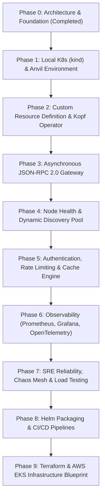

# KubeChain Engineering Roadmap

This document outlines the phased development roadmap for KubeChain, moving from architecture and repository foundation through local Kubernetes orchestration, data plane implementation, security controls, observability, and production cloud infrastructure.

---

## Development Milestones

---

### Phase 0: Architecture & Repository Foundation
*Status: Complete*

- [x] Analyze master system specification and identify distributed failure modes.
- [x] Author comprehensive technical architecture:
  - System topology & scope boundaries ([docs/architecture/system-design.md](architecture/system-design.md))
  - Component designs & CRD schemas ([docs/architecture/component-design.md](architecture/component-design.md))
  - Request & reconciliation data flows ([docs/architecture/data-flow.md](architecture/data-flow.md))
  - Threat modeling & RBAC security ([docs/architecture/security-model.md](architecture/security-model.md))
  - Multi-tier testing strategy ([docs/architecture/testing-strategy.md](architecture/testing-strategy.md))
- [x] Author Architecture Decision Records (`001`, `ADR-001`, `ADR-002`, `ADR-003`).
- [x] Initialize PEP 621 Python packaging, Ruff linting, Mypy type-checking, and Pytest test runner.
- [x] Implement baseline test validation harness ([tests/unit/test_foundation.py](../tests/unit/test_foundation.py)).
- [x] Establish automated GitHub Actions CI workflow ([.github/workflows/ci.yaml](../.github/workflows/ci.yaml)).

---

### Phase 1: Local Kubernetes & Blockchain Environment
*Status: In Progress / Next Milestone*

- [ ] Install local toolchain dependencies (`kind`, `helm`).
- [ ] Implement `kind` cluster configuration with mapped host ports (`deploy/local/kind-config.yaml`):
  - Port 8000: Gateway HTTP endpoint
  - Port 8545: Anvil JSON-RPC endpoint
  - Port 9090: Prometheus metrics endpoint
- [ ] Author deterministic Anvil container workload with persistent state storage.
- [ ] Author automated verification scripts asserting EVM JSON-RPC protocol compliance (`eth_chainId`, `eth_blockNumber`, `net_version`).

---

### Phase 2: Custom Resource Definition & Python Kubernetes Operator
*Status: Planned*

- [ ] Author OpenAPI v3 `BlockchainNode` Custom Resource Definition manifest (`deploy/crds/`).
- [ ] Implement Pydantic models for CR spec, status, and conditions (`api/v1alpha1/`).
- [ ] Implement Kopf operator reconciler lifecycle (`operator/src/reconciler.py`).
- [ ] Implement child resource builders: StatefulSet, Headless Service, ClusterIP Service, and PodDisruptionBudget.
- [ ] Implement state diffing engine to detect and correct configuration drift.
- [ ] Implement Kubernetes status subresource conditions reporter.
- [ ] Author operator unit and reconciliation mock tests.

---

### Phase 3: Asynchronous JSON-RPC Gateway
*Status: Planned*

- [ ] Implement FastAPI application lifecycle and middleware stack (`gateway/src/main.py`).
- [ ] Implement Pydantic JSON-RPC 2.0 schemas for single requests, batch requests, responses, and error objects (`gateway/src/rpc/models.py`).
- [ ] Implement high-throughput HTTPX client with persistent connection pooling (`gateway/src/rpc/client.py`).
- [ ] Implement method categorization and execution policies (`gateway/src/rpc/methods.py`):
  - Bounded retries with exponential backoff and jitter for idempotent read methods.
  - Zero retries for state-mutating transactions (`eth_sendRawTransaction`).
- [ ] Implement standard JSON-RPC 2.0 error framing (`-32700`, `-32600`, `-32601`, `-32602`, `-32603`, `-32000`).

---

### Phase 4: Node Health & Dynamic Discovery Pool
*Status: Planned*

- [ ] Implement `NodeHealthEvaluator` interface with `AnvilProfile` and `EVMConsensusProfile` (`node_manager/`).
- [ ] Implement background active probing engine polling every $N$ seconds for `eth_chainId`, `eth_blockNumber`, `eth_syncing`, and latency.
- [ ] Implement node state classification machine: `HEALTHY`, `SYNCING`, `LAGGING`, `UNREACHABLE`, `DEGRADED`.
- [ ] Implement thread-safe dynamic `RoutingPool` (Least Connections & Latency-Biased selection).
- [ ] Author integration tests verifying automated traffic draining from degraded/lagging backends.

---

### Phase 5: Authentication, Rate Limiting & Cache Engine
*Status: Planned*

- [ ] Implement API key extraction and SHA-256 lookup middleware (`gateway/src/middleware/auth.py`).
- [ ] Implement Redis-backed sliding-window rate limiter using atomic Lua scripts (`gateway/src/middleware/ratelimit.py`).
- [ ] Implement Compute Unit (CU) method weighting table (`eth_blockNumber`=10, `eth_call`=26, `eth_sendRawTransaction`=100).
- [ ] Implement canonical JSON-RPC parameter serializer and SHA-256 cache key generator (`gateway/src/cache/rules.py`).
- [ ] Implement fail-open Redis cache engine with circuit-breaking capabilities (`gateway/src/cache/engine.py`).
- [ ] Author integration tests for rate-limit exhaustion (HTTP 429) and Redis outage bypass.

---

### Phase 6: Observability Plane
*Status: Planned*

- [ ] Implement Prometheus metrics exporter with strictly bounded label cardinality (`gateway/src/telemetry/metrics.py`).
- [ ] Instrument request pipeline with OpenTelemetry spans and W3C TraceContext propagation (`gateway/src/telemetry/tracing.py`).
- [ ] Author Grafana dashboard JSON definitions for Gateway latency/throughput and backend node health (`observability/grafana/`).
- [ ] Implement Prometheus alert rules for high node lag, elevated 5xx rates, and cache degradation (`observability/prometheus/`).

---

### Phase 7: SRE Reliability, Chaos & Load Testing
*Status: Planned*

- [ ] Author Chaos Mesh experiment definitions (`chaos/`):
  - Primary Anvil pod termination during continuous load.
  - Redis network partition / outage simulation.
  - Operator pod crash and recovery verification.
  - Upstream network latency injection.
- [ ] Implement k6 load test scenarios targeting 1,000 requests/second (`tests/load/`).
- [ ] Verify zero dropped requests for idempotent read operations during node restarts.

---

### Phase 8: Helm Packaging & CI/CD
*Status: Planned*

- [ ] Author unified Helm chart for Operator, Gateway, Redis, and CRDs (`deploy/helm/kubechain/`).
- [ ] Implement Helm values schemas with configurable resource limits and security contexts.
- [ ] Implement multi-stage GitHub Actions CI/CD workflows for linting, testing, container builds, and Helm linting.

---

### Phase 9: Terraform & AWS EKS Infrastructure Blueprint
*Status: Planned*

- [ ] Author Terraform modules for production AWS EKS infrastructure (`infra/terraform/`):
  - VPC with public/private subnets across multiple AZs.
  - EKS cluster with managed node groups.
  - IAM Roles for Service Accounts (IRSA) for minimal AWS permissions.
  - Helm release orchestration for external-dns, cert-manager, and metrics-server.
