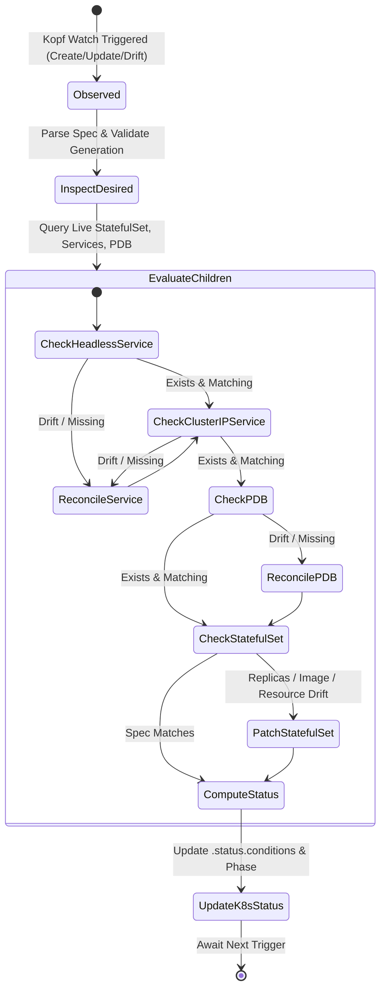
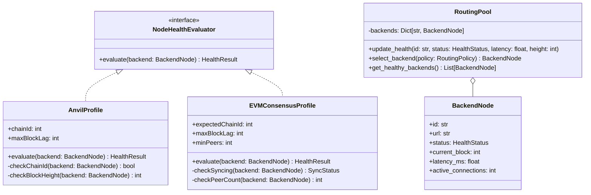

# KubeChain Component Design Specification

## 1. Custom Resource Definition: `BlockchainNode`

The platform surface area is defined by the `BlockchainNode` Custom Resource Definition (`infra.kubechain.io/v1alpha1`).

### OpenAPI v3 Structural Schema Specification

```yaml
apiVersion: apiextensions.k8s.io/v1
kind: CustomResourceDefinition
metadata:
  name: blockchainnodes.infra.kubechain.io
spec:
  group: infra.kubechain.io
  names:
    kind: BlockchainNode
    listKind: BlockchainNodeList
    plural: blockchainnodes
    singular: blockchainnode
    shortNames:
      - bcn
  scope: Namespaced
  versions:
    - name: v1alpha1
      served: true
      storage: true
      subresources:
        status: {}
        scale:
          specReplicasPath: .spec.replicas
          statusReplicasPath: .status.replicas
      schema:
        openAPIV3Schema:
          type: object
          required: [spec]
          properties:
            spec:
              type: object
              required: [chain, network, client]
              properties:
                chain:
                  type: string
                  enum: [ethereum, polygon, arbitrum, local-anvil]
                  description: "Target blockchain ecosystem."
                network:
                  type: string
                  description: "Network identifier (e.g., mainnet, sepolia, anvil-dev)."
                client:
                  type: string
                  enum: [anvil, geth, besu, nethermind]
                  description: "Underlying EVM client binary."
                replicas:
                  type: integer
                  minimum: 1
                  maximum: 32
                  default: 1
                  description: "Desired number of node replicas."
                image:
                  type: object
                  properties:
                    repository:
                      type: string
                    tag:
                      type: string
                    pullPolicy:
                      type: string
                      enum: [Always, IfNotPresent, Never]
                      default: IfNotPresent
                storage:
                  type: object
                  properties:
                    enabled:
                      type: boolean
                      default: true
                    storageClassName:
                      type: string
                    size:
                      type: string
                      pattern: '^[0-9]+(Gi|Mi|Ti)$'
                      default: "10Gi"
                resources:
                  type: object
                  properties:
                    limits:
                      type: object
                      properties:
                        cpu:
                          type: string
                        memory:
                          type: string
                    requests:
                      type: object
                      properties:
                        cpu:
                          type: string
                        memory:
                          type: string
                rpcPort:
                  type: integer
                  minimum: 1024
                  maximum: 65535
                  default: 8545
                healthCheck:
                  type: object
                  properties:
                    intervalSeconds:
                      type: integer
                      minimum: 1
                      default: 10
                    timeoutSeconds:
                      type: integer
                      minimum: 1
                      default: 3
                    maxBlockLag:
                      type: integer
                      minimum: 0
                      default: 10
            status:
              type: object
              properties:
                phase:
                  type: string
                  enum: [Pending, Creating, Running, Degraded, Failed, Terminating]
                observedGeneration:
                  type: integer
                replicas:
                  type: integer
                readyReplicas:
                  type: integer
                healthyBackends:
                  type: integer
                currentBlockHeight:
                  type: integer
                lastReconcileTime:
                  type: string
                  format: date-time
                conditions:
                  type: array
                  items:
                    type: object
                    required: [type, status, lastTransitionTime, reason, message]
                    properties:
                      type:
                        type: string
                      status:
                        type: string
                        enum: ["True", "False", "Unknown"]
                      lastTransitionTime:
                        type: string
                        format: date-time
                      reason:
                        type: string
                      message:
                        type: string
```

---

## 2. Operator Reconciliation Lifecycle

The operator controller watches `BlockchainNode` instances and enforces the desired cluster state.



### Deterministic Naming Conventions
- Parent CR: `<name>`
- Headless Service: `<name>-internal` (`spec.clusterIP: None`, `publishNotReadyAddresses: true`)
- ClusterIP Service: `<name>-rpc` (`spec.ports[0].port: <rpcPort>`)
- StatefulSet: `<name>-sts`
- Pod Disruption Budget: `<name>-pdb` (`spec.maxUnavailable: 1`)
- Pod Labels: `app.kubernetes.io/name: kubechain-node`, `infra.kubechain.io/cr-name: <name>`

---

## 3. Node Discovery & Active Health Engine



### Health Status Definitions
- `HEALTHY`: Node responds with valid JSON-RPC, `eth_chainId` matches CR spec, block height is within `maxBlockLag` of cluster maximum, `eth_syncing == false`, and p95 latency < 1500ms.
- `SYNCING`: Responds to JSON-RPC, but reports `eth_syncing: { startingBlock, currentBlock, highestBlock }`.
- `LAGGING`: Responds, but `cluster_max_height - node_height > maxBlockLag`.
- `DEGRADED`: Responds with HTTP 200, but latency > 1500ms or response framing fails JSON-RPC 2.0 schema.
- `UNREACHABLE`: TCP connection refused, socket timeout, or HTTP 5xx error.

---

## 4. Asynchronous JSON-RPC Gateway Architecture

The Gateway is engineered with FastAPI and HTTPX using non-blocking asynchronous I/O.

```mermaid
flowchart TD
    ClientReq["HTTP POST /v1/rpc"] --> Middleware["FastAPI Middleware Stack"]
    
    subgraph Pipeline["Gateway Execution Pipeline"]
        Middleware --> Auth["1. Auth Middleware: SHA-256 API Key Validation"]
        Auth --> Parse["2. Protocol Parser: JSON-RPC 2.0 Schema Validation"]
        Parse --> RateLimit["3. Rate Limiting: Redis Compute Unit Check"]
        RateLimit --> CacheCheck{"4. Cache Policy Check"}
        
        CacheCheck -->|Cacheable & Hit| CacheReturn["Return Cached JSON-RPC Response"]
        CacheCheck -->|Miss or Uncacheable| RouteSelect["5. Select Backend from Healthy Pool"]
        
        RouteSelect --> UpstreamExec["6. Execute Upstream HTTPX POST"]
        UpstreamExec --> EvaluateRes{"7. Evaluate Response & Retry Policy"}
        
        EvaluateRes -->|Success & Cacheable| CacheWrite["Write to Redis with TTL"]
        EvaluateRes -->|Transient Failure & Retriable| RetryLoop["Retry Next Healthy Node"]
        EvaluateRes -->|Non-Retriable (eth_sendRawTx)| ReturnErr["Return JSON-RPC Error Frame"]
        
        RetryLoop --> RouteSelect
        CacheWrite --> FormatRes["Format Standard JSON-RPC 2.0 Response"]
    end
    
    CacheReturn --> ClientRes["Client HTTP 200 Response"]
    FormatRes --> ClientRes
    ReturnErr --> ClientRes
```

---

## 5. Security & Rate-Limiting Policy Design

### Compute Unit (CU) Method Weight Table

| JSON-RPC Method | CU Weight | Caching Rule | Retry Rule |
| :--- | :--- | :--- | :--- |
| `eth_chainId` | 10 | Immutable (24h) | Bounded Retry (Max 2) |
| `net_version` | 10 | Immutable (24h) | Bounded Retry (Max 2) |
| `eth_blockNumber` | 10 | Dynamic (1s TTL) | Bounded Retry (Max 2) |
| `eth_getBalance` | 20 | Dynamic (5s TTL) | Bounded Retry (Max 2) |
| `eth_getTransactionReceipt` | 20 | Finalized: 24h, Unfinalized: 3s | Bounded Retry (Max 2) |
| `eth_getTransactionByHash` | 20 | Finalized: 24h, Unfinalized: 3s | Bounded Retry (Max 2) |
| `eth_getBlockByNumber` | 30 | Finalized: 24h, Latest: 1s | Bounded Retry (Max 2) |
| `eth_call` | 26 | Uncached by default | Bounded Retry (Max 2) |
| `eth_getLogs` | 75 | Finalized block ranges: 1h | Bounded Retry (Max 1) |
| `eth_sendRawTransaction` | 100 | **NEVER CACHED** | **ZERO RETRIES** |

### Redis Sliding-Window Rate Limiter (Atomic Lua Implementation)
Rate limiting uses a sorted set (ZSET) per API key:
1. `key`: `kubechain:ratelimit:<api_key_hash>`
2. Remove timestamps older than `(current_timestamp - 1.0)`.
3. Sum the CU weights of all entries in the 1-second window.
4. If `current_cu + request_cu > quota_per_second`, reject with HTTP 429 (`X-RateLimit-Reset`, `Retry-After`).
5. Else, insert current entry `ZADD key current_timestamp (uuid:weight)` and proceed.

---

## 6. Observability Specifications: Prometheus Metrics

All metrics strictly adhere to bounded cardinality rules:

```
# GATEWAY METRICS
kubechain_gateway_requests_total{method="eth_call", status="success", chain_id="31337"}
kubechain_gateway_request_duration_seconds_bucket{method="eth_call", le="0.05"}
kubechain_gateway_active_connections{chain_id="31337"}
kubechain_gateway_rate_limited_total{tier="default"}

# CACHE METRICS
kubechain_cache_operations_total{operation="hit", method="eth_getBlockByNumber"}
kubechain_cache_operations_total{operation="miss", method="eth_getBlockByNumber"}
kubechain_cache_operations_total{operation="error", method="eth_getBlockByNumber"}

# BACKEND & HEALTH METRICS
kubechain_backend_status{backend_id="node-0", status="HEALTHY"}
kubechain_backend_latency_seconds_bucket{backend_id="node-0", le="0.1"}
kubechain_backend_block_height{backend_id="node-0"}
kubechain_backend_block_lag{backend_id="node-0"}

# OPERATOR METRICS
kubechain_operator_reconcile_total{resource="BlockchainNode", result="success"}
kubechain_operator_reconcile_duration_seconds_bucket{resource="BlockchainNode", le="0.5"}
```
