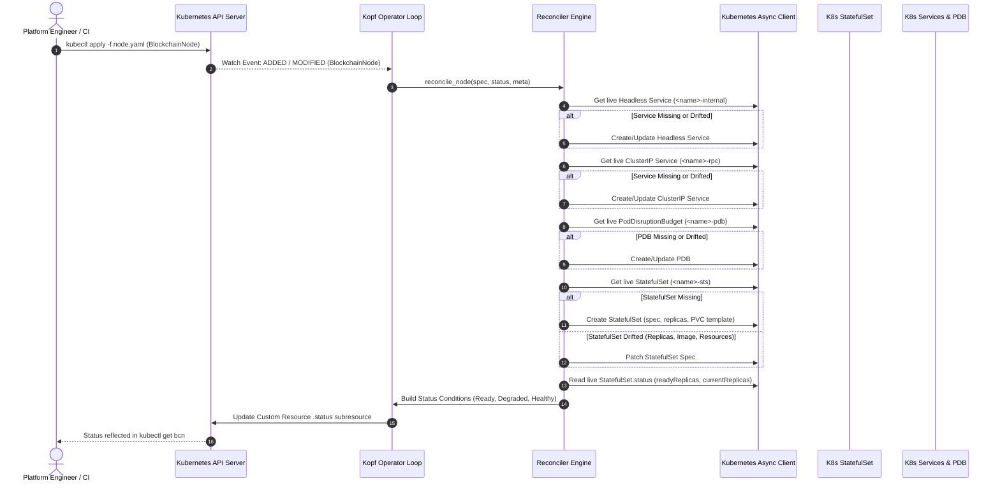
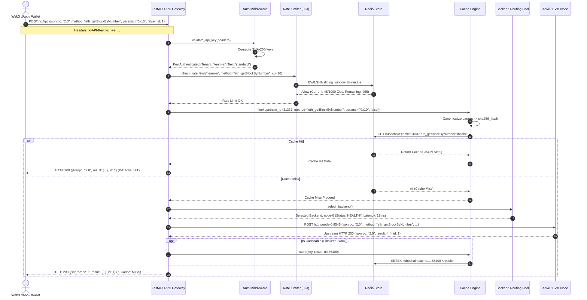
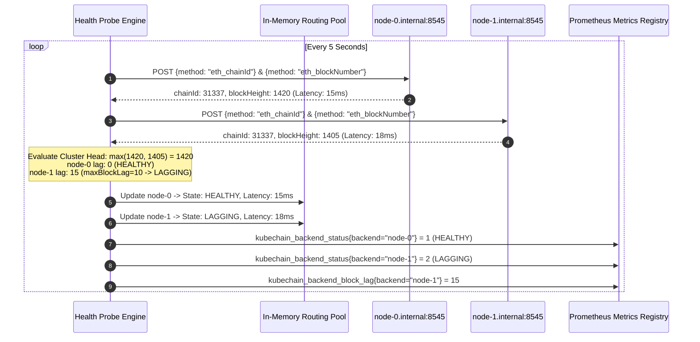
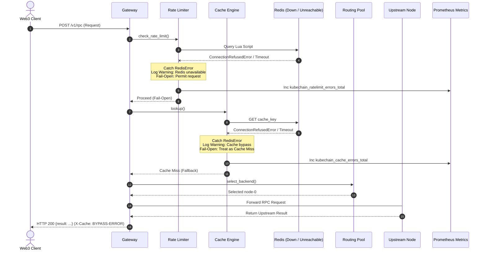

# KubeChain Data Flow & Sequence Specifications

## 1. Control Plane: CRD Reconciliation Flow

This sequence illustrates the end-to-end lifecycle when a user or GitOps workflow applies a `BlockchainNode` Custom Resource into the Kubernetes cluster.

---

## 2. Data Plane: JSON-RPC Request Execution Flow

This sequence models the complete lifecycle of a client JSON-RPC request through the Gateway, showing the interplay between authentication, rate-limiting, caching, and upstream routing.

---

## 3. Node Health Probing & Dynamic Routing Updates

This sequence models the background asynchronous discovery and health evaluation loop.

---

## 4. Resilience Flow: Redis Outage & Fail-Open Behavior

This sequence models the system's resilience when the Redis cache/rate-limiting cluster experiences a partition or crash.

