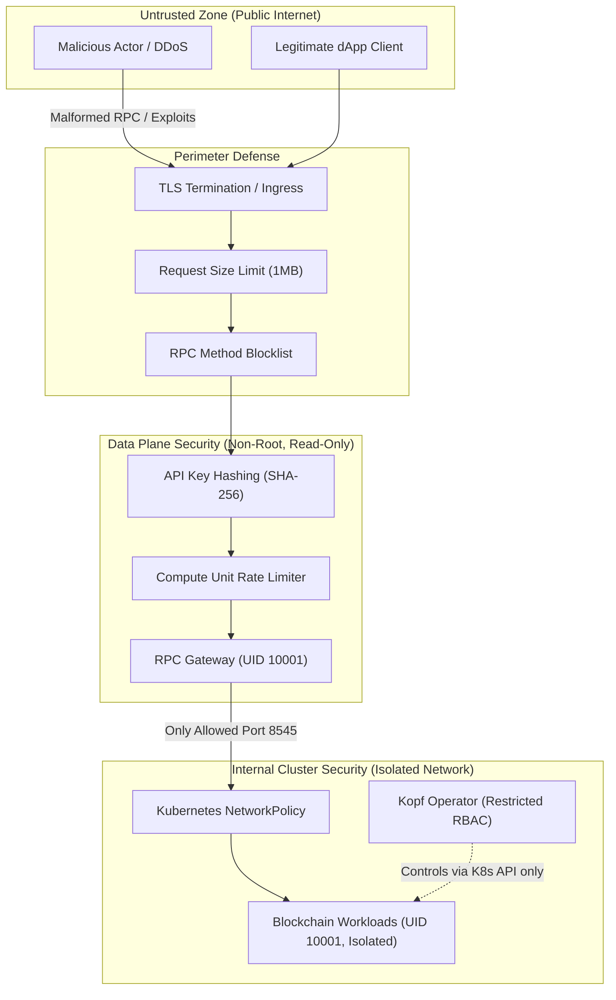

# KubeChain Security Architecture & Threat Model

## 1. Threat Modeling & Attack Surface Overview

The KubeChain platform operates at the boundary between public Web3 client traffic and private Kubernetes cluster infrastructure. A robust defense-in-depth model prevents unauthorized cluster mutations, denial of service, and ledger poisoning.



---

## 2. Principle of Least Privilege: Kubernetes RBAC

The KubeChain Operator is granted only the exact verbs and API groups necessary to reconcile `BlockchainNode` child resources. It holds zero cluster-admin permissions.

### ClusterRole Definition (`deploy/rbac/operator-role.yaml`)

```yaml
apiVersion: rbac.authorization.k8s.io/v1
kind: ClusterRole
metadata:
  name: kubechain-operator-role
rules:
  # 1. Custom Resource Definition Permissions
  - apiGroups: ["infra.kubechain.io"]
    resources: ["blockchainnodes"]
    verbs: ["get", "list", "watch", "update", "patch"]
  - apiGroups: ["infra.kubechain.io"]
    resources: ["blockchainnodes/status"]
    verbs: ["get", "update", "patch"]

  # 2. StatefulSet Management
  - apiGroups: ["apps"]
    resources: ["statefulsets"]
    verbs: ["get", "list", "watch", "create", "update", "patch", "delete"]

  # 3. Core Services and Pods
  - apiGroups: [""]
    resources: ["services"]
    verbs: ["get", "list", "watch", "create", "update", "patch", "delete"]
  - apiGroups: [""]
    resources: ["pods", "pods/status"]
    verbs: ["get", "list", "watch"]
  - apiGroups: [""]
    resources: ["persistentvolumeclaims"]
    verbs: ["get", "list", "watch"]

  # 4. PodDisruptionBudgets
  - apiGroups: ["policy"]
    resources: ["poddisruptionbudgets"]
    verbs: ["get", "list", "watch", "create", "update", "patch", "delete"]

  # 5. Events Emission
  - apiGroups: [""]
    resources: ["events"]
    verbs: ["create", "patch"]
```

*Note*: The Gateway service account has **zero** Kubernetes RBAC permissions. It cannot list, read, or mutate any Kubernetes API resources.

---

## 3. JSON-RPC Attack Surface & Method Filtering

Blockchain nodes provide administrative and debug methods that must **never** be exposed via a public or tenant-facing RPC gateway.

### Dangerous Methods Blocklist (Enforced by Gateway Router)
The Gateway explicitly rejects the following methods with JSON-RPC error `-32601` (Method not found):
- Administrative: `admin_*` (e.g., `admin_addPeer`, `admin_nodeInfo`, `admin_datadir`)
- Key Management: `personal_*` (e.g., `personal_unlockAccount`, `personal_newAccount`)
- Mining & Consensus: `miner_*`, `engine_*`
- Debug & Profiling: `debug_*` (e.g., `debug_traceTransaction`, `debug_dumpBlock`)
- Anvil Developer Specific: `anvil_*` (e.g., `anvil_setBalance`, `anvil_impersonateAccount`, `anvil_mine`)

### Safe Method Allowlist
- Queries: `eth_chainId`, `net_version`, `eth_blockNumber`, `eth_gasPrice`, `eth_getBalance`, `eth_getStorageAt`, `eth_getTransactionCount`, `eth_getBlockTransactionCountByHash`, `eth_getBlockTransactionCountByNumber`, `eth_getCode`, `eth_call`, `eth_estimateGas`, `eth_getBlockByHash`, `eth_getBlockByNumber`, `eth_getTransactionByHash`, `eth_getTransactionReceipt`
- Filter & Logs: `eth_getLogs` (with enforced maximum block range, e.g., $\Delta \le 5000$)
- Transactions: `eth_sendRawTransaction` (validated as valid hex string)

---

## 4. Container & Pod Security Standards

Both the Operator, Gateway, and Node pods comply with the Kubernetes **Restricted Pod Security Standard**:

```yaml
securityContext:
  runAsNonRoot: true
  runAsUser: 10001
  runAsGroup: 10001
  fsGroup: 10001
  seccompProfile:
    type: RuntimeDefault
containers:
  - name: workload
    securityContext:
      allowPrivilegeEscalation: false
      readOnlyRootFilesystem: true
      capabilities:
        drop:
          - ALL
    volumeMounts:
      - name: tmp-volume
        mountPath: /tmp
```

---

## 5. Network Isolation via Kubernetes NetworkPolicies

To prevent lateral movement within the cluster, `NetworkPolicies` isolate blockchain node workloads so they only accept traffic originating from the KubeChain Gateway within the target namespace.

```yaml
apiVersion: networking.k8s.io/v1
kind: NetworkPolicy
metadata:
  name: kubechain-node-isolation
  namespace: default
spec:
  podSelector:
    matchLabels:
      app.kubernetes.io/name: kubechain-node
  policyTypes:
    - Ingress
  ingress:
    # Allow traffic ONLY from the KubeChain Gateway pods
    - from:
        - podSelector:
            matchLabels:
              app.kubernetes.io/name: kubechain-gateway
      ports:
        - protocol: TCP
          port: 8545
```
