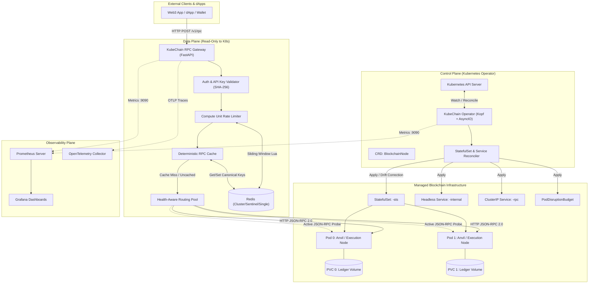

# KubeChain System Design (V1)

## 1. Executive Summary & Vision

**KubeChain** is a Kubernetes-native platform for declaratively provisioning, managing, monitoring, and exposing EVM-compatible blockchain RPC infrastructure. It bridges the gap between modern cloud-native operational paradigms (declarative specifications, automated reconciliation, self-healing) and the operational realities of distributed blockchain nodes (stateful append-only ledgers, synchronization lag, reorg-aware caching, and non-idempotent JSON-RPC methods).

The platform enables platform engineers and dApp developers to declare their blockchain node requirements via Kubernetes Custom Resources (`BlockchainNode`). KubeChain automatically orchestrates the underlying StatefulSets, headless peer services, cluster routing, health probing, reorg-safe caching, compute-unit rate limiting, and Prometheus/OpenTelemetry observability.

Version 1 focuses on a robust, highly testable local Kubernetes deployment using `kind` and deterministic `Anvil` backends, establishing rigorous abstractions so that production consensus/execution clients (Geth, Besu, Nethermind, Lighthouse) can be introduced seamlessly in future versions.

---

## 2. High-Level Architectural Topology

---

## 3. Subsystem Decomposition & Responsibilities

The system is partitioned into four independent architectural layers with strict boundaries:

### A. Control Plane (`operator/`)
- **Single Source of Truth**: The `BlockchainNode` Custom Resource Definition (`infra.kubechain.io/v1alpha1`).
- **Autonomous Reconciliation**: Implemented using Kopf and `kubernetes-asyncio`. Continuously observes desired state vs. live cluster state.
- **Resource Ownership**: Generates, provisions, and maintains StatefulSets, Headless Services (`ClusterIP: None`), ClusterIP Services, PVC volume claim templates, and PodDisruptionBudgets (PDB).
- **Drift Correction**: Detects manual alterations to managed Kubernetes objects and resets them to the desired state.
- **Status Reporting**: Aggregates pod readiness, storage status, and observed generation into standard Kubernetes `.status.conditions`.

### B. Data Plane (`gateway/`)
- **JSON-RPC 2.0 Gateway**: Asynchronous FastAPI/Uvicorn server accepting single and batch requests.
- **Security & Authentication**: API key validation via SHA-256 hashed lookup.
- **Compute Unit (CU) Rate Limiting**: Redis-backed atomic sliding-window algorithm that weights requests by computational cost (e.g., `eth_blockNumber` = 10 CUs, `eth_call` = 26 CUs, `eth_sendRawTransaction` = 100 CUs).
- **Reorg-Safe Caching**: Deterministic hashing of normalized JSON-RPC methods and parameters. Finalized blocks are cached long-term; pending/latest blocks are never immutably cached. Fail-open architecture prevents Redis outages from degrading RPC availability.
- **Upstream Forwarding & Retry Logic**: Bounded retries for idempotent queries (`eth_getBlockByNumber`, `eth_chainId`); strictly **zero retries** for stateful transactions (`eth_sendRawTransaction`).

### C. Node Management & Health Probing (`node_manager/`)
- **Active Probing**: Polls backends every $N$ seconds for `eth_chainId`, `eth_blockNumber`, `eth_syncing`, and request latency.
- **State Classification**: Classifies each node as `HEALTHY`, `SYNCING`, `LAGGING`, `UNREACHABLE`, or `DEGRADED`.
- **Dynamic Routing Table**: In-memory thread-safe routing pool consumed by the Gateway. Routes traffic strictly to nodes in `HEALTHY` (or configured read-replica) state.

### D. Observability & Reliability Plane (`observability/`, `chaos/`)
- **Prometheus Metrics**: High-cardinality-free metrics tracking request latencies, cache hit ratios, rate-limit drops, node block lag, and operator reconciliation durations.
- **Distributed Tracing**: OpenTelemetry instrumentation linking incoming HTTP requests through auth, rate-limiting, cache lookup, backend selection, and upstream execution.
- **Chaos & Load Verification**: Automated verification scripts executing pod termination, network latency injection, Redis failure, and k6 load tests.

---

## 4. Scope: What V1 Supports vs. What V1 Does Not Support

### What V1 Explicitly Supports
1. **Local Kubernetes Deployment**: Orchestration inside local `kind` (Kubernetes-in-Docker) clusters.
2. **Anvil EVM Backend**: Automated lifecycle management of local Foundry/Anvil EVM execution nodes via StatefulSets.
3. **Multi-Node Routing Pool**: Gateway discovers and routes traffic across multiple independent local Anvil instances or explicitly configured test fixtures.
4. **Deterministic Health Classification**: Distinguishes Anvil liveness from simulated block lag and connection failure.
5. **Strict JSON-RPC 2.0 Compliance**: Full validation of request headers, batches, IDs, and standard error codes (`-32700` parse error, `-32600` invalid request, `-32601` method not found, `-32602` invalid params, `-32603` internal error).
6. **Resilient Caching**: Redis-backed caching with SHA-256 canonical parameter hashing and automatic fail-open on Redis timeout/disconnection.
7. **Granular Rate Limiting**: Tiered Compute-Unit rate limiting implemented using atomic Lua scripts.
8. **End-to-End Observability**: Standardized Prometheus metrics and OpenTelemetry trace spans.

### What V1 Does Not Support (Deferred to Future Milestones)
1. **Production Consensus Clients**: Does not deploy PoS Consensus Clients (Prysm, Lighthouse, Teku) or the Ethereum Engine API (`engine_forkchoiceUpdated`, `engine_newPayload`).
2. **Synchronized Mainnet/Testnet Clusters**: Anvil instances run independently and do not peer via Ethereum DevP2P / Discv5. Multiple Anvil pods are treated as isolated test backends or read fixtures, not a consensus-synchronized cluster.
3. **Public Commercial Billing**: No Stripe, fiat payment, or billing webhook integration.
4. **Dynamic Autoscaling (KEDA / HPA)**: V1 relies on declarative replica counts in the `BlockchainNode` CR rather than automated load-based horizontal pod autoscaling.
5. **Multi-Region Cross-Cluster Federation**: Cluster orchestration is scoped to a single Kubernetes cluster namespace.

---

## 5. Anvil Limitations & Evolution to Production EVM

### Known Limitations of Anvil in Infrastructure Testing
1. **No P2P Consensus Synchronization**: Anvil is a local developer tool. It does not synchronize with remote nodes over the Ethereum wire protocol (ETH/68). It does not exhibit genuine `eth_syncing` transitions (stages: headers, bodies, state trie).
2. **Instant Block Sealing**: By default, Anvil seals blocks immediately upon transaction receipt unless explicitly configured with `--block-time <seconds>`.
3. **Single-Threaded RPC Processing**: Under heavy concurrent loads, Anvil's internal JSON-RPC server can queue requests, leading to synthetic latency spikes not representative of production Geth or Erigon.
4. **Non-Persistent State Across Restarts (Unless Mounted)**: Without `--dump-state` and `--load-state` mapped to a persistent volume, restarting an Anvil pod creates an empty blockchain from genesis.

### Migration Path to Production Ethereum Infrastructure (V2+)
To support production Ethereum nodes (e.g., Geth + Lighthouse), KubeChain's modular design enables the following transitions without rewriting the gateway or operator core:
1. **Engine API & JWT Secret Management**:
   The operator will generate a Kubernetes `Secret` containing a 32-byte hex JWT secret, mounted into both the Execution Client (Geth) and Consensus Client (Lighthouse) for authenticated `http://localhost:8551` Engine API communication.
2. **Multi-Container Pod Architecture**:
   Each `BlockchainNode` pod will run two containers:
   - `execution`: Geth / Besu / Nethermind exposed on port 8545 (JSON-RPC) and port 30303 (DevP2P).
   - `consensus`: Lighthouse / Prysm exposed on port 5052 (Beacon REST) and port 9000 (Discv5).
3. **Real Sync State Validation**:
   The `NodeHealthEvaluator` will switch from the `AnvilProfile` to the `EVMConsensusProfile`:
   - Checks `eth_syncing` for sync stage, current block, and highest known block.
   - Queries beacon node `/eth/v1/node/syncing`.
   - Asserts `net_peerCount >= minPeerThreshold`.
